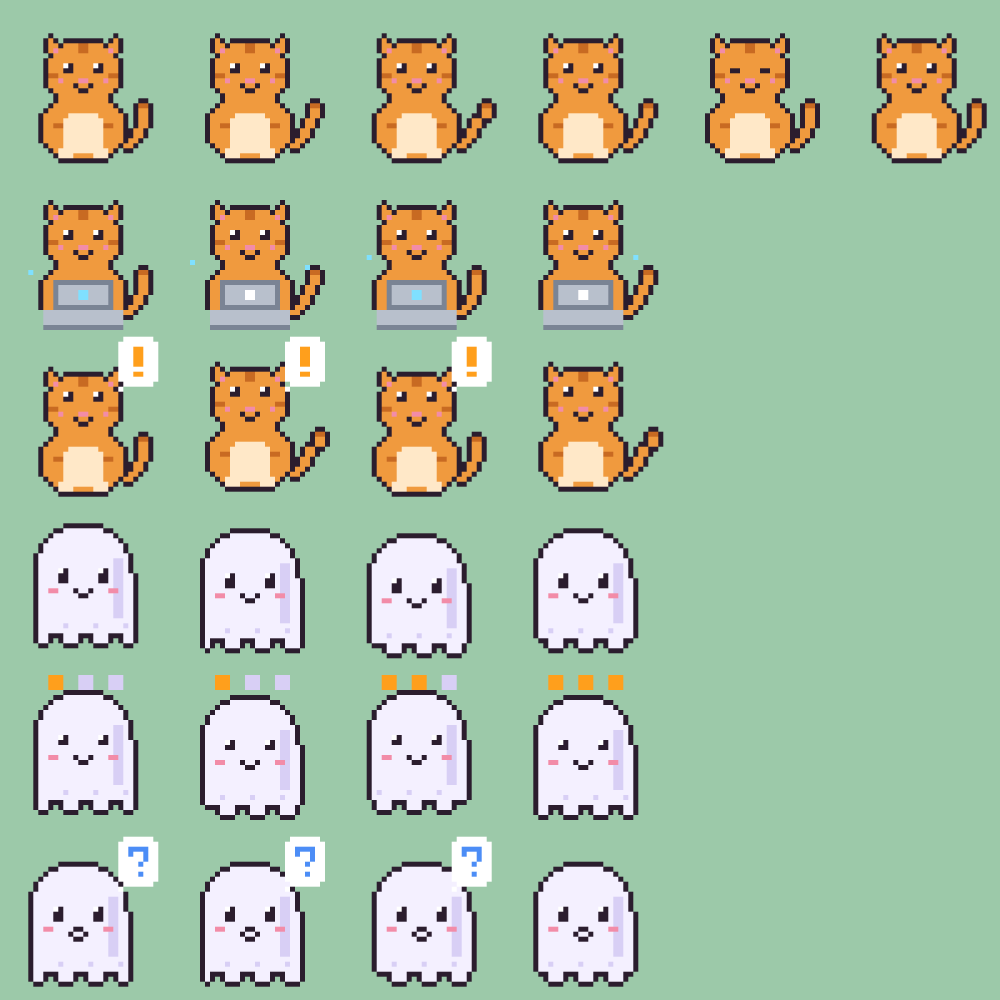

# Desk Pets

Little pixel pets that sit on your macOS desktop. Each pet is bound to one Claude Code or Codex
session and shows at a glance whether that session is **working**, **waiting for you**, or **idle**.

A native Swift/AppKit menu bar app, built for people who run a dozen agent sessions at once:
under 1 MB, starts in well under a second, and stays near 0% CPU while the pets play.

<!-- TODO: add docs/screenshot.png (pets on a desktop) and show it here. -->
> 📸 *Screenshot coming soon.*



## Features

- Menu bar app with no Dock icon: **Show Pets**, **Manage…**, **Launch at Login**, **Quit**.
- One borderless, always-on-top pet per session, visible on every Space and over full-screen apps.
  Drag it anywhere and the position is remembered.
- Hover a pet to see the session name and state. Double-click it to bring the session's terminal app
  to the front; in [cmux](https://cmux.dev) it also switches to the session's workspace and tab.
  Right-click it to change the character or unbind it.
- Sessions get readable names: the `/rename` title, else the cmux tab title, else Claude's
  auto-generated title, else `folder · pid`. Transcripts are read from the end in small chunks and
  cached, so even 100 MB transcripts cost almost nothing.
- Finds `claude` and `codex` sessions with `sysctl`/`libproc` every 2.5 s, without forking `ps`.
- State comes from Claude Code / Codex hooks, pushed to the app through a watched folder (no polling).
- Bindings follow a session across restarts: same CLI + same working directory re-attaches automatically.
- Custom characters from your own GIFs. Two original built-in characters: a cat and a ghost.

| State | Meaning | Hook events |
| --- | --- | --- |
| working | the agent is busy | `UserPromptSubmit`, `PreToolUse`, `PostToolUse`, `PreCompact` |
| waiting | needs your reply or approval | `Notification` (permission / idle prompt), `PermissionRequest` |
| idle | finished its turn | `Stop`, `SessionStart` |
| unknown | no hooks installed, so the pet plays its idle animation | – |

## Install

**Download** `DeskPets.app` from the Releases page and drag it to `/Applications`.
The app is ad-hoc signed, so the first time you open it, right-click → **Open**.

**Or build it yourself** (macOS 14+, Swift 6 toolchain; the Command Line Tools are enough, no Xcode needed):

```sh
git clone https://github.com/youngOman/desk-pets.git
cd desk-pets
make app          # → build/DeskPets.app
make run          # build and open
make test         # unit tests
```

## Install the hooks

Without hooks every pet shows *unknown*. To get live states:

1. Click the paw icon in the menu bar → **Manage…** → **Hooks** → **Install Hooks**.
2. Restart your Claude Code / Codex sessions so they load the new hooks.

This merges a few entries into `~/.claude/settings.json` and `~/.codex/hooks.json`. Your existing hooks
are kept, and each file is backed up as `settings.json.deskpets-<time>.bak` before it is changed.
**Remove Hooks** takes out only the Desk Pets entries.

You can do the same thing from a terminal:

```sh
/Applications/DeskPets.app/Contents/MacOS/deskpets-hook install            # or: uninstall
/Applications/DeskPets.app/Contents/MacOS/deskpets-hook install --home /tmp/test-home   # try it on a scratch HOME
/Applications/DeskPets.app/Contents/MacOS/deskpets-hook list               # detected sessions and states
/Applications/DeskPets.app/Contents/MacOS/deskpets-hook pets hide          # or: show
```

The hook command points to the app's current location. If you move the app, run **Install Hooks** again.
Codex may also need hooks turned on in its own config. Check the Codex docs for your version.

## Custom characters

A character is a folder of GIFs:

| File | Required | Played when |
| --- | --- | --- |
| `idle.gif` | yes | idle or unknown |
| `working.gif` | no (falls back to idle) | working |
| `waiting.gif` | no (falls back to idle) | waiting |

In **Manage… → Characters → Add Character…**, give it a name and choose one to three GIFs, or drop them
into the sheet (files named `idle`/`working`/`waiting` go to the right slot). They are copied to
`~/Library/Application Support/DeskPets/characters/<name>/`. You can also drop a folder there
yourself, or run:

```sh
/Applications/DeskPets.app/Contents/MacOS/DeskPets import-character Mochi idle.gif working.gif waiting.gif
```

Pets are drawn at 64, 96 or 128 px (pick one in the manager). Pixel art is scaled without smoothing,
so 32×32 sprites stay crisp. The built-in sprites are generated by `tools/make_sprites.swift`
(`make sprites`).

## Privacy

Desk Pets never touches the network. Everything stays on your Mac:

- The hook writes only metadata (CLI, session id, event name, state, working directory, pid) to
  `~/Library/Application Support/DeskPets/sessions/`. Prompts, tool input, and output are never stored.
- Settings live in `~/Library/Application Support/DeskPets/config.json`.
- The only files outside that folder it changes are the two hook config files, and only when you
  click Install/Remove Hooks.

## Performance

Measured on an Apple Silicon Mac with 17 live sessions (`ps -o %cpu,rss`, averaged over 30 s):

| | |
| --- | --- |
| App size | ~0.8 MB |
| Launch → menu bar icon | ~150–450 ms |
| 3 pets animating | ~0.1% CPU, ~51 MB RSS |
| Pets hidden | ~0.1% CPU (the 2.5 s session scan) |

Animations run as Core Animation keyframes, so the app does no per-frame work. Animations stop
while a pet is hidden or fully covered.

## Acknowledgements

Inspired by Evan's agent-pets.

## License

MIT © youngOman. The built-in characters are original art generated by the script in `tools/` and
are covered by the same license.

---

## 繁體中文說明

Desk Pets 是一個 macOS 選單列小工具，在桌面上放幾隻像素小寵物。每隻寵物綁一個 Claude Code 或 Codex session，
一眼就能看出它是「工作中」、「等你回覆」還是「閒置」。原生 Swift／AppKit 寫成，App 不到 1 MB，啟動不到一秒，
寵物播動畫時 CPU 幾乎是 0%。

**安裝**：下載 `DeskPets.app` 放進「應用程式」（第一次開啟請按右鍵 →「打開」），或自己執行 `make app` 建置。

**安裝 hooks**：選單列的爪子圖示 →「管理…」→「Hooks」→「安裝 hooks」，然後重開 session。
程式會把設定合併進 `~/.claude/settings.json` 和 `~/.codex/hooks.json`，保留你原本的 hooks，
修改前備份成 `*.deskpets-<時間>.bak`。「移除 hooks」只會拿掉 Desk Pets 自己的項目。

**自訂角色**：「管理…」→「角色」→「新增角色…」，取名後選一到三張 GIF（也可以直接拖進來）：
`idle.gif` 必填；`working.gif`、`waiting.gif` 可以不給，沒給就用 idle。
可以調整顯示大小（64／96／128 px），也可以刪除自訂角色。

**操作**：拖曳寵物可以移動，位置會記住；滑鼠移上去會顯示 session 名稱和狀態；
雙擊會把那個 session 所在的終端機叫到前景（在 cmux 裡會直接切到那個分頁）；右鍵可以換角色或解除綁定。
session 名稱依序取：`/rename` 取的名字 → cmux 分頁標題 → Claude 自動產生的標題 → 「資料夾 · pid」。
session 重開後 pid 會變，只要是同一個 CLI、同一個工作目錄，寵物會自動接回去。

**隱私**：完全在本機讀寫，不連網。hook 只記錄 session id、事件、狀態、工作目錄、pid 這些資訊，
不會記錄你的對話內容。

**致謝**：靈感來自 Evan 的 agent-pets。
